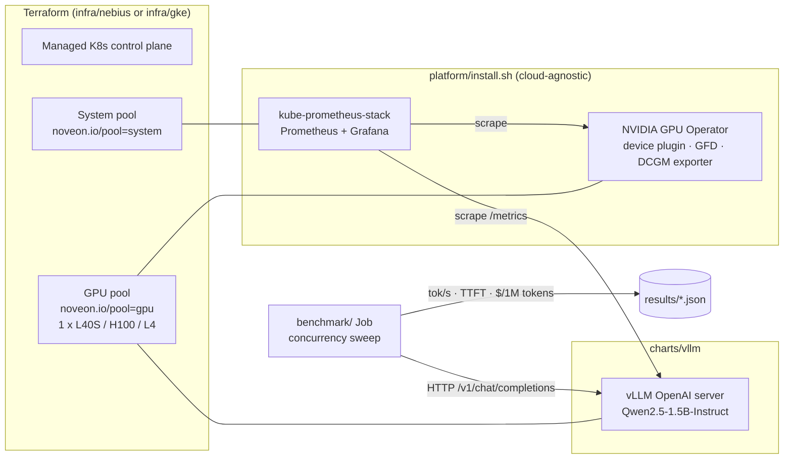

# GPU Inference Platform: Nebius AI Cloud ⇄ GKE

A reproducible reference architecture for serving open LLMs on Kubernetes GPUs, with GPU-level observability and a **cost-per-token** benchmark. The same Helm charts, dashboards and benchmark run on **Nebius Managed Kubernetes** and **Google Kubernetes Engine**. Only the Terraform module changes.

It answers the questions a team asks before moving inference to a GPU cloud:

1. How long does it take to stand up a production-shaped GPU cluster, and can it be torn down cleanly?
2. What throughput and latency does one GPU deliver for my model, and at what concurrency does it saturate?
3. **What does a million output tokens cost** on each GPU class and each cloud?

> **Status:** infrastructure and platform code complete; benchmark results are added after each run under [`results/`](results/).

---

## Architecture



| Layer | Nebius | GKE |
|---|---|---|
| Cluster | `nebius_mk8s_v1_cluster`, public API endpoint | Zonal `google_container_cluster`, Workload Identity |
| System pool | 2 × `cpu-d3` `4vcpu-16gb` | 1 × `e2-standard-4` |
| GPU pool | 1 × `gpu-l40s-a` `1gpu-8vcpu-32gb` (driver-included image) | 1 × `g2-standard-8` (L4, GKE-managed driver) |
| GPU metrics | GPU Operator DCGM exporter → Prometheus | GKE managed DCGM → Managed Prometheus |
| Serving | `charts/vllm` (identical) | `charts/vllm` (identical) |

Design decisions are recorded in [`docs/adr/`](docs/adr/).

## Repository layout

```
infra/nebius/        Terraform: Managed Kubernetes, system + GPU node groups
infra/gke/           Terraform: the same shape on GKE
platform/            install.sh + Helm values (Prometheus/Grafana, GPU Operator)
charts/vllm/         Helm chart: vLLM server, Service, ServiceMonitor
benchmark/           bench.py (async load generator), job.yaml, report.py
dashboards/          Grafana dashboard: vLLM serving + DCGM GPU panels
docs/                ADRs and runbook
results/             Benchmark outputs and SUMMARY.md
```

## Quick start (Nebius)

Prerequisites: Nebius CLI with an authenticated profile (`nebius profile create`), Terraform ≥ 1.6, `kubectl`, `helm`, `jq`. Quotas in the target region: ≥ 1 GPU of the chosen type, ≥ 8 non-GPU vCPUs, ≥ 4 disks.

```bash
make env                 # shows the project and subnet Terraform will use
make init
make plan
make up                  # ~10-15 min: control plane + node groups
make kubeconfig
make platform            # Prometheus/Grafana, GPU Operator, dashboards
make deploy              # vLLM; first start downloads the model
make bench GPU_HOURLY_USD=<on-demand price> LABEL="nebius L40S eu-north1"
make grafana             # http://localhost:3000, dashboard "GPU Inference"
make down                # destroy, then list anything still billable
```

Between sessions, `make gpu-off` scales the GPU pool to zero and keeps the cluster. `make down` removes everything.

**GKE:** the same flow with `CLOUD=gke` after copying `infra/gke/terraform.tfvars.example` to `terraform.tfvars`.

## What the benchmark measures

`benchmark/bench.py` runs **inside the cluster**, so laptop-to-region latency does not distort time-to-first-token. For each concurrency level (default 1, 4, 16, 32, 64) it sends streaming chat requests with ~512 input tokens and exactly 256 output tokens (`ignore_eos`), then records:

- aggregate **output tokens/sec**
- **TTFT** and **end-to-end latency** at p50 and p95
- **$ per 1M output tokens** = GPU hourly price ÷ (tokens/sec × 3600) × 1,000,000

Prompts differ per request so vLLM's prefix cache cannot make later requests artificially cheap. `make report` turns every run into a comparison table in `results/SUMMARY.md`.

## Cost controls

- One GPU node; system components are pinned to cheap CPU nodes.
- `make gpu-off` / `make down`; `make leftovers` lists any instance, disk or cluster still in the project.
- A tenant-wide budget with 25/50/75/100% alerts is set in the Nebius console before any `apply`.

## Not in scope (yet)

Multi-node training, InfiniBand, autoscaling on queue depth (KEDA or Prometheus Adapter), a private API endpoint behind a bastion, and remote Terraform state. Each is listed in [`docs/runbook.md`](docs/runbook.md) as a next step, with the reason it was deferred.
