# GPU Inference Platform: Nebius AI Cloud ⇄ GKE

A reproducible reference architecture for serving open LLMs on Kubernetes GPUs, with GPU-level observability and a **cost-per-token** benchmark. The same Helm charts, dashboards and benchmark run on **Nebius Managed Kubernetes** and **Google Kubernetes Engine**. Only the Terraform module changes.

It answers the questions a team asks before moving inference to a GPU cloud:

1. How long does it take to stand up a production-shaped GPU cluster, and can it be torn down cleanly?
2. What throughput and latency does one GPU deliver for my model, and at what concurrency does it saturate?
3. **What does a million output tokens cost** on each GPU class and each cloud?

> **Status:** benchmarked on Nebius (1 x L40S, eu-north1) on 2026-10-12 and on GKE (1 x L4, us-central1) on 2026-10-13. Both clusters were destroyed after each run. Raw results and the full tables are in [`results/`](results/).

## Results

Qwen2.5-1.5B-Instruct on vLLM v0.31.0, same Helm chart and benchmark on both clouds. Each request has a ~512-token prompt and generates exactly 256 output tokens. Prices are on-demand list prices for the whole GPU node.

| | Nebius L40S (eu-north1) | GKE L4 (us-central1) |
|---|---:|---:|
| Node | 1 GPU, 8 vCPU, 32 GiB | g2-standard-8: 1 GPU, 8 vCPU, 32 GiB |
| Price | $1.55/h | $0.85/h |
| Peak output tok/s (concurrency 64) | **6,228** | 2,181 |
| TTFT p95 at concurrency 64 | **586 ms** | 1,892 ms |
| E2E p95 at concurrency 64 | **2.72 s** | 8.72 s |
| **$ per 1M output tokens** | **$0.069** | $0.109 |

**The cheaper GPU is the more expensive way to serve tokens.** The L4 costs 45% less per hour, but the L40S delivers 2.9x the throughput, so it is 37% cheaper per output token and 3x faster to first token under load. Token generation is mostly limited by how fast the GPU can read memory, and the L40S reads memory about 2.9x faster than the L4 (864 vs 300 GB/s), which matches the throughput gap. Compare GPUs by $ per token at your target latency, not by $ per hour.

All 960 requests succeeded across both runs. Cost per token falls 30x or more between one user and 64 concurrent users on both GPUs, so batching is the main cost lever for self-hosted inference. Throughput was still climbing at concurrency 64 on both, so neither GPU was saturated by this 1.5B model.

<details>
<summary>Per-concurrency results</summary>

**Nebius L40S, $1.55/h**

| Concurrency | Output tok/s | TTFT p50 | TTFT p95 | E2E p95 | $ per 1M output tokens |
|---:|---:|---:|---:|---:|---:|
| 1 | 188 | 23 ms | 24 ms | 1.36 s | $2.29 |
| 4 | 682 | 47 ms | 55 ms | 1.51 s | $0.63 |
| 16 | 2,529 | 90 ms | 172 ms | 1.65 s | $0.17 |
| 32 | 4,111 | 190 ms | 296 ms | 2.02 s | $0.10 |
| 64 | 6,228 | 359 ms | 586 ms | 2.72 s | **$0.069** |

**GKE L4, $0.85/h**

| Concurrency | Output tok/s | TTFT p50 | TTFT p95 | E2E p95 | $ per 1M output tokens |
|---:|---:|---:|---:|---:|---:|
| 1 | 74 | 51 ms | 54 ms | 3.48 s | $3.21 |
| 4 | 276 | 160 ms | 168 ms | 3.72 s | $0.86 |
| 16 | 934 | 338 ms | 564 ms | 4.47 s | $0.25 |
| 32 | 1,493 | 517 ms | 922 ms | 5.86 s | $0.16 |
| 64 | 2,181 | 675 ms | 1,892 ms | 8.72 s | **$0.109** |

</details>

Cost covers the GPU node only. The control plane and the CPU system node are excluded on both clouds.

### Screenshots: Nebius

**vLLM serving metrics during the benchmark (Grafana).** The spike at 16:36 is the five concurrency steps run back to back, and latency rises with concurrency. The small bump at 16:30 is the first run, which was rejected (see below).

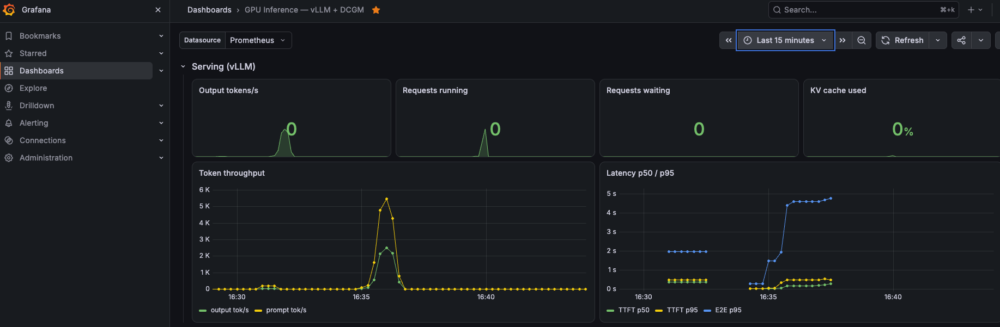

The same panels over 30 minutes, with the benchmark in context of the idle cluster:

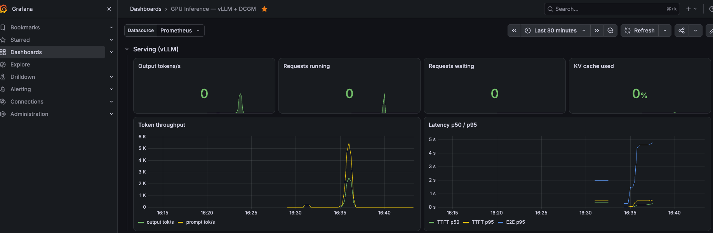

**Kubernetes API server health (kube-prometheus-stack).** The control plane stayed above 99.9% availability while the platform was installed and the benchmark ran.

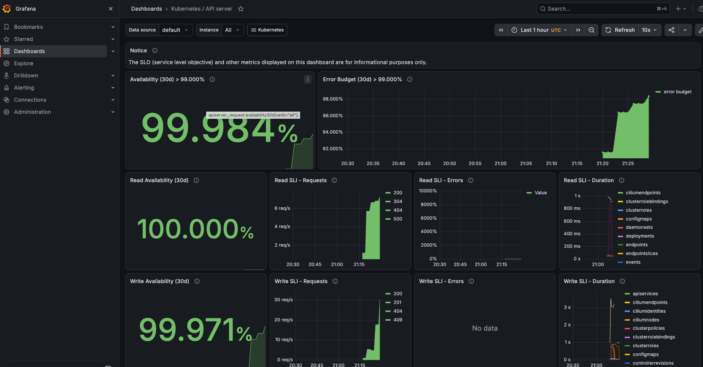

**Cluster on Nebius: one CPU system node and one L40S GPU node.**

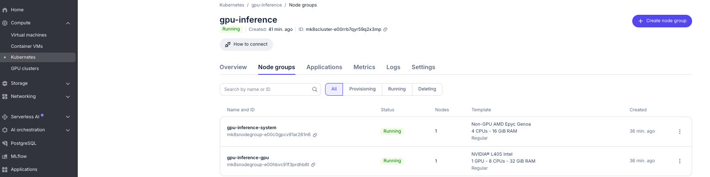

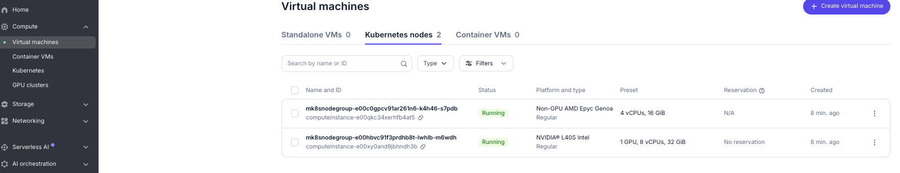

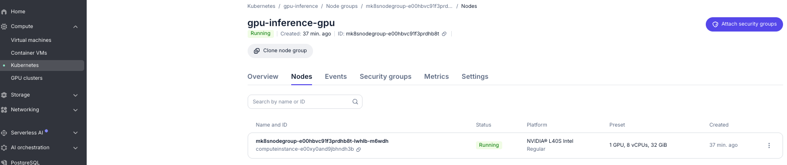

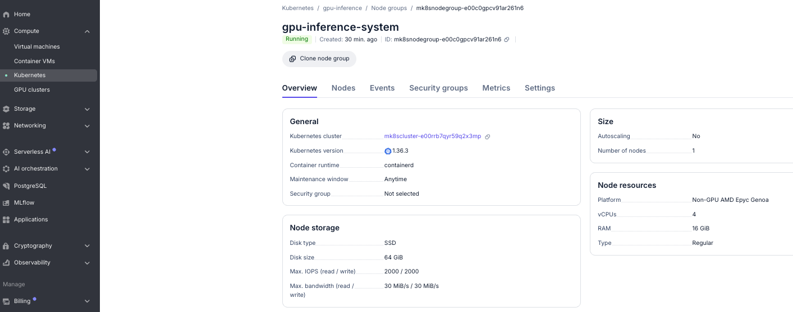

**GPU node during startup.** CPU and disk activity at 16:18–16:25 is the ~10 GB vLLM image pull and model load, before the benchmark ran.

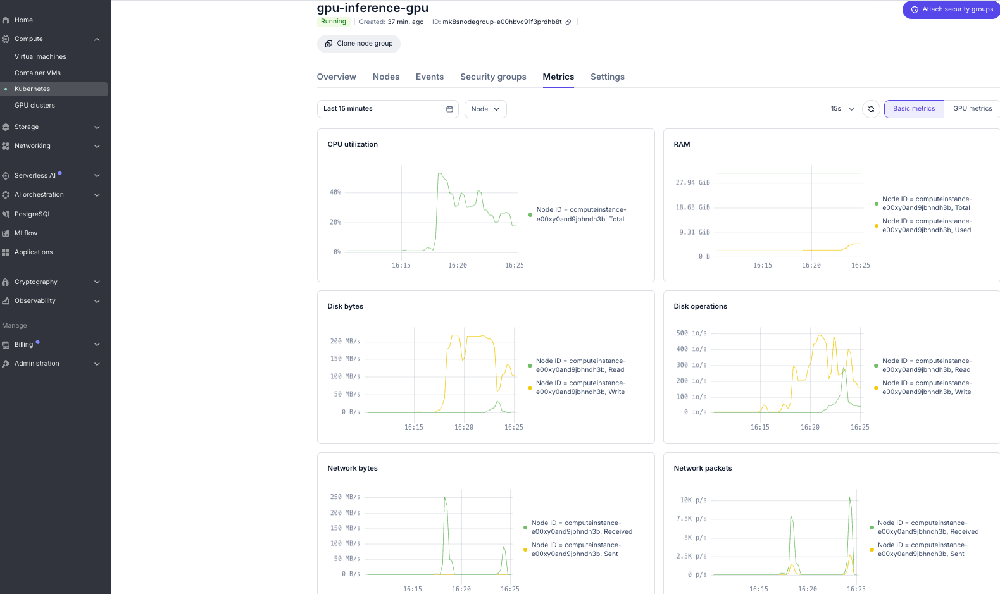

**Teardown.** `make down` in progress: the system node is already gone and the GPU node is deleting.

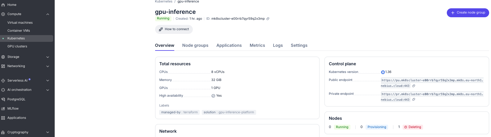

### Screenshots: GKE

**L4 under the benchmark (GKE Observability → Accelerators → DCGM, filtered to the vLLM pod).** GPU utilisation goes from 0 to 100% for the benchmark at about 8:52 pm CST and back to 0. The SM clock rises to ~2 GHz and the temperature to ~60 °C. The gauges show the average over the 15-minute window, not the peak.

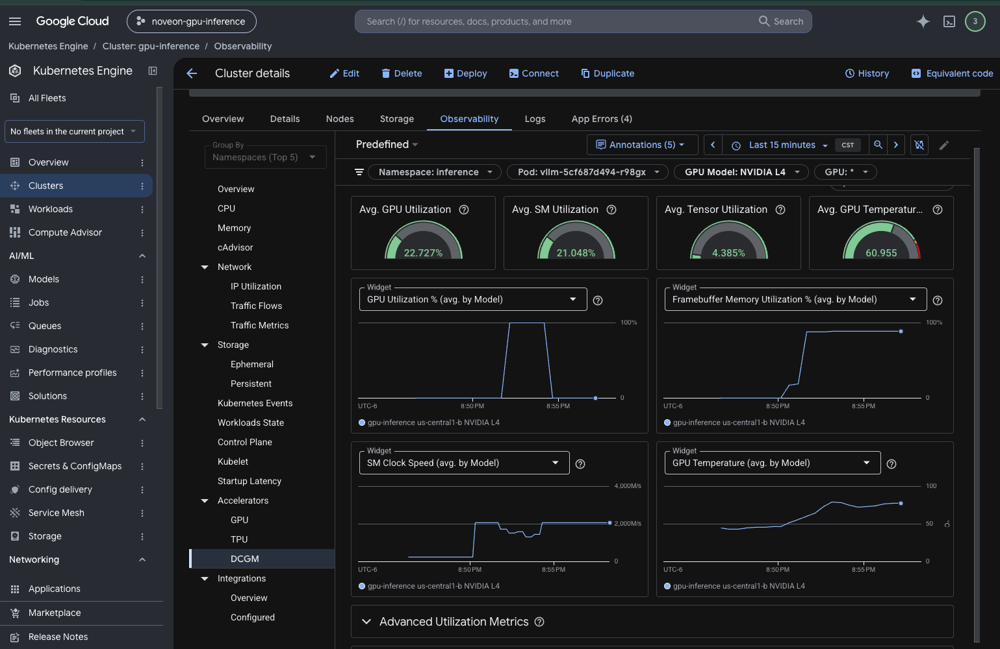

**GPU summary (Accelerators → GPU).** Idle time drops from 100% to 0 during the run. Most of the ~22 GB of memory in use is vLLM reserving 90% of the GPU at startup for its KV cache (`gpuMemoryUtilization: 0.90`), not memory pressure from the load.

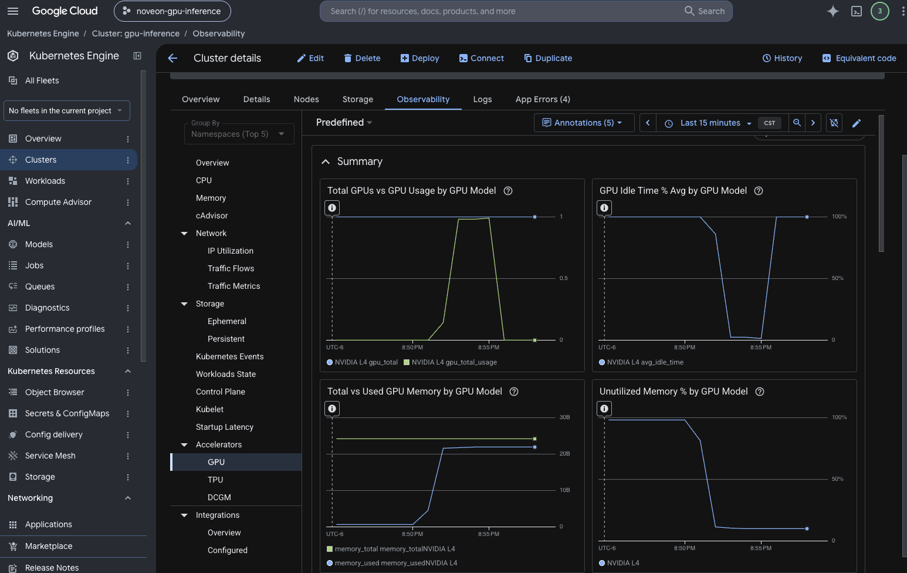

### What the runs taught us

**Nebius**

- **Instance quota, not GPU quota, was the binding limit.** The tenant had 8 L40S GPUs but only 2 compute instances, so the system pool runs 1 node instead of 2 (`-var cpu_node_count=1`).
- **The Service name `vllm` breaks vLLM.** Kubernetes injects `VLLM_PORT=tcp://...` for a Service named `vllm`, and vLLM reads it as its own setting and exits. The chart now sets `enableServiceLinks: false`.
- **Synthetic filler tokens are expensive.** Strings like `context12_34` cost ~7 tokens each, so the first prompts were ~3,800 tokens and every request was rejected. The benchmark now uses common English words, measured at 516 tokens with vLLM's `/tokenize` endpoint.
- **DCGM GPU metrics on Nebius need three changes (fixed).** Nebius labels GPU nodes `nvidia.com/gpu.deploy.operands=false`, runs its own device plugin, and holds the host's DCGM profiling module. The first run's exporter crashed with "third-party Profiling module returned an unrecoverable error". `platform/install.sh` now relabels GPU nodes to `operands=true`, the operator's device plugin is disabled, and the exporter uses [`dcgm-metrics-nebius.csv`](platform/values/dcgm-metrics-nebius.csv), which leaves out the profiling fields (1001–1012). GPU utilisation, memory, power and temperature now reach Grafana. The "Graphics engine active" panel stays empty on Nebius because it is a profiling metric. Nebius overrides a node-template label, so nodes added by autoscaling need the same relabel.

**GKE**

- **A Free Trial billing account cannot use GPUs.** The global `GPUS_ALL_REGIONS` quota is 0, and an increase request was denied automatically within 10 seconds. After upgrading the billing account, the same request was approved in about a minute.
- **Zones run out of capacity.** The first `make up` failed in us-central1-a with "does not have enough resources available". The same plan in us-central1-b succeeded, and the L4 node took 9.5 minutes to provision.
- **Boot disks count against the SSD quota.** GKE's default pd-balanced disks use `SSD_TOTAL_GB` (250 GB on a new project). The GPU node's disk is 100 GB so that both pools fit.
- **GKE's managed DCGM exporter only feeds Google's hosted Prometheus.** `platform/gke-dcgm-podmonitor.yaml` adds a PodMonitor, so the in-cluster Prometheus and the Grafana GPU panels get the same metrics.
- **Use your own project for quota API calls.** Without `--billing-project`, `gcloud beta quotas` was rate-limited on gcloud's shared client project.

## Autoscaling test: KEDA + Cluster Autoscaler (Nebius, 2026-10-13)

The chain under test: load rises → **KEDA** adds a vLLM replica → the replica cannot fit (one GPU per node) → **Nebius's Cluster Autoscaler** adds an L40S node → the replica serves → load drops → the replica and node go away.

**Setup.** The GPU pool autoscales between 1 and 2 L40S nodes (`-var gpu_node_count=1 -var gpu_max_node_count=2`). The project's quota of 2 compute instances means no separate CPU system pool, so monitoring shares the first GPU node. The vLLM chart's `autoscaling.enabled=true` creates a KEDA `ScaledObject` on requests in flight (`vllm:num_requests_running + vllm:num_requests_waiting`) with a target of 40 per replica, read from the in-cluster Prometheus. `make load` held 96 concurrent requests.

| Time (UTC) | Event |
|---|---|
| 03:29 | The pool starts at its **maximum** (2 nodes), not its minimum. One node is cordoned so everything lands on the other. |
| 03:50 | The idle node becomes a scale-down candidate, after `cilium-operator` is moved off it (see below). |
| 04:01:45 | **Cluster Autoscaler removes the idle node.** Pool: 1 node. |
| 04:02:00 | Load starts: 96 concurrent requests on 1 replica. |
| 04:02:38 | **KEDA scales vLLM to 2** (96 in flight vs target 40). The replica is Pending (no free GPU). |
| 04:03:03 | **Cluster Autoscaler adds an L40S node** (registered 25 s after the pod went Pending; Ready at 04:03:30). |
| 04:11:46 | Replica 2 is Ready on the new node (~5 min image pull + ~3 min model load). Traffic splits 39/43 requests. |
| 04:13:37 | Load stopped. |
| 04:19:08 | **KEDA/HPA scales vLLM back to 1** (the HPA's default 5-minute scale-down window). |

Throughput from the load client, per minute ([timeline](results/autoscaling/nebius-l40s-keda-20261013T0402Z-timeline.txt)):

| Replicas serving | Output tok/s | TTFT p95 |
|---|---:|---:|
| 1 (minutes 1–9) | ~7,700 | 400–740 ms |
| 2 (minute 11) | **10,620 (+38%)** | **213 ms (−46%)** |

Zero failed requests throughout. Throughput rises 38% rather than doubling because the client holds a fixed 96 requests: two replicas each run a batch of 48 instead of one running 96. The second GPU buys lower latency at the same load, or headroom for roughly twice the users.

**What the test taught us**

- **Time to capacity is dominated by the image, not the node.** The L40S node was Ready 52 s after the replica went Pending. The 10 GB vLLM image and model load took another 8 minutes. A pre-pulled image or a shared model cache (runbook next steps) is the biggest lever for scale-out speed.
- **A Nebius autoscaling pool starts at its maximum size.** Expect to pay for `max_node_count` nodes until the autoscaler removes the idle ones about 10–20 minutes later.
- **`cilium-operator` blocks scale-down on a GPU-only cluster.** It runs 2 replicas with anti-affinity in `kube-system`, and the autoscaler will not remove a node running a non-DaemonSet `kube-system` pod. On a cluster with only the GPU pool, the second GPU node can never scale away. A small CPU system pool (needs a 3rd instance of quota) gives those pods a home.
- **KEDA's `cooldownPeriod` applies only to scaling to zero.** Scaling 2 → 1 follows the HPA's 5-minute stabilization window. Tune that window with `advanced.horizontalPodAutoscalerConfig` if needed.

### Screenshots: autoscaling

**Both L40S GPUs in the autoscaling pool (Nebius console → Kubernetes cluster → GPU metrics).** Node 1 (green) hits 100% when the load starts at 23:02 (CST). The node added by the autoscaler (yellow) has 0 MB of frame buffer used until the vLLM image and model load at about 23:10, then fills to ~40 GB (vLLM's KV-cache reservation) and joins at 100% at 23:11. Both drop to 0% when the load stops at 23:14. The used-frame-buffer legend still lists the node the autoscaler removed at 23:01.

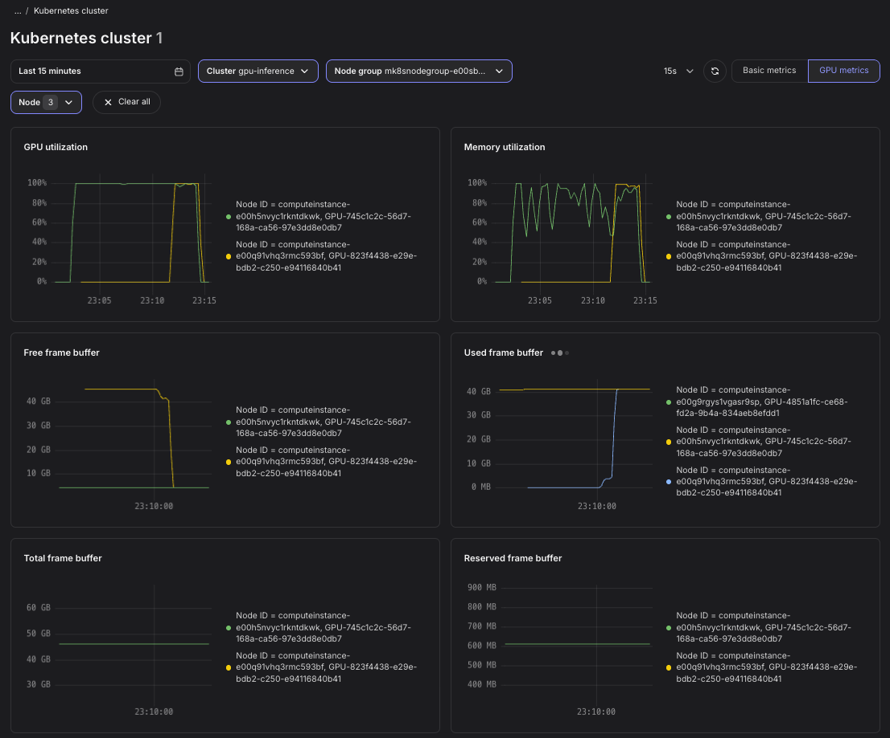

The same view a minute later, after the load stopped:

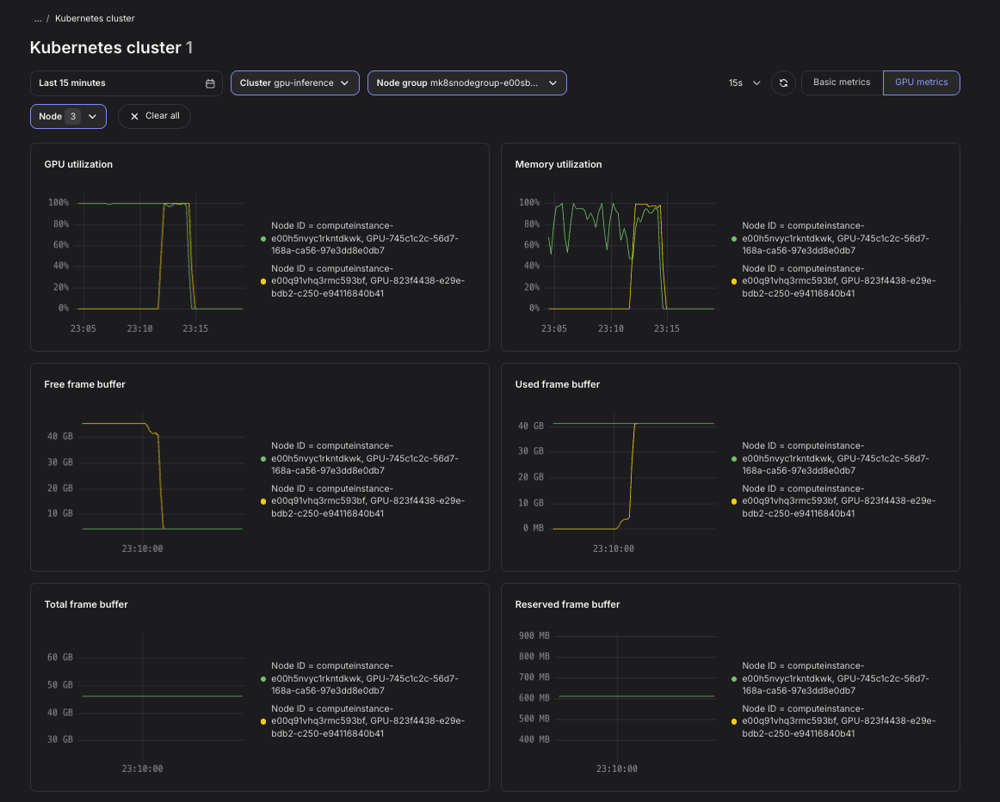

Under load each L40S drew ~300 W (limit 350 W) with the SM clock at ~2.5 GHz and no throttling (peak ~55 °C). Idle with the model loaded it drew ~100 W, and ~35 W once vLLM was gone. An idle replica costs about three times the power of an empty GPU, which is the energy case for scaling replicas to zero.

---

## Architecture

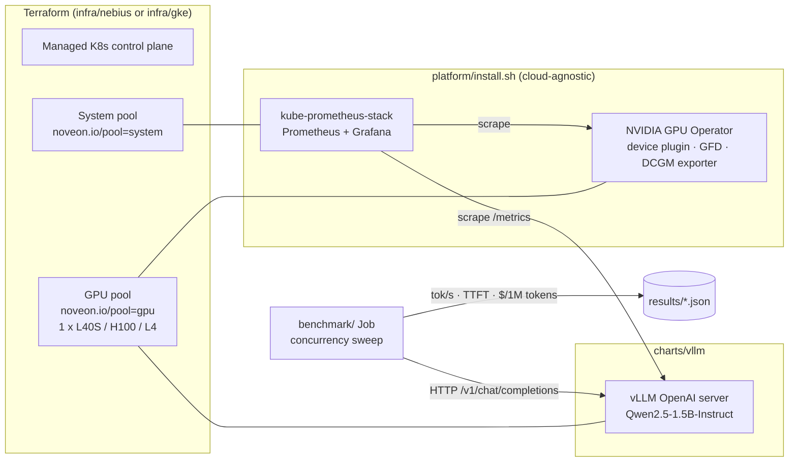

| Layer | Nebius | GKE |
|---|---|---|
| Cluster | `nebius_mk8s_v1_cluster`, public API endpoint | Zonal `google_container_cluster`, Workload Identity |
| System pool | 2 × `cpu-d3` `4vcpu-16gb` | 1 × `e2-standard-4` |
| GPU pool | 1 × `gpu-l40s-a` `1gpu-8vcpu-32gb` (driver-included image) | 1 × `g2-standard-8` (L4, GKE-managed driver) |
| GPU metrics | GPU Operator DCGM exporter → Prometheus | GKE managed DCGM → Managed Prometheus |
| Serving | `charts/vllm` (identical) | `charts/vllm` (identical) |

Design decisions are recorded in [`docs/adr/`](docs/adr/).

## Repository layout

```
infra/nebius/        Terraform: Managed Kubernetes, system + GPU node groups
infra/gke/           Terraform: the same shape on GKE
platform/            install.sh + Helm values (Prometheus/Grafana, GPU Operator)
charts/vllm/         Helm chart: vLLM server, Service, ServiceMonitor
benchmark/           bench.py (async load generator), job.yaml, report.py
dashboards/          Grafana dashboard: vLLM serving + DCGM GPU panels
docs/                ADRs and runbook
results/             Benchmark outputs and SUMMARY.md
```

## Quick start (Nebius)

Prerequisites: Nebius CLI with an authenticated profile (`nebius profile create`), Terraform ≥ 1.6, `kubectl`, `helm`, `jq`. Quotas in the target region: ≥ 1 GPU of the chosen type, ≥ 8 non-GPU vCPUs, ≥ 4 disks.

```bash
make env                 # shows the project and subnet Terraform will use
make init
make plan
make up                  # ~10-15 min: control plane + node groups
make kubeconfig
make platform            # Prometheus/Grafana, GPU Operator, dashboards
make deploy              # vLLM; first start downloads the model
make bench GPU_HOURLY_USD=<on-demand price> LABEL="nebius L40S eu-north1"
make grafana             # http://localhost:3000, dashboard "GPU Inference"
make down                # destroy, then list anything still billable
```

Between sessions, `make gpu-off` scales the GPU pool to zero and keeps the cluster. `make down` removes everything.

**GKE:** the same flow with `CLOUD=gke` after copying `infra/gke/terraform.tfvars.example` to `terraform.tfvars`.

## What the benchmark measures

`benchmark/bench.py` runs **inside the cluster**, so laptop-to-region latency does not distort time-to-first-token. For each concurrency level (default 1, 4, 16, 32, 64) it sends streaming chat requests with ~512 input tokens and exactly 256 output tokens (`ignore_eos`), then records:

- aggregate **output tokens/sec**
- **TTFT** and **end-to-end latency** at p50 and p95
- **$ per 1M output tokens** = GPU hourly price ÷ (tokens/sec × 3600) × 1,000,000

Prompts differ per request so vLLM's prefix cache cannot make later requests artificially cheap. `make report` turns every run into a comparison table in `results/SUMMARY.md`.

## Cost controls

- One GPU node; system components are pinned to cheap CPU nodes.
- `make gpu-off` / `make down`; `make leftovers` lists any instance, disk or cluster still in the project.
- A tenant-wide budget with 25/50/75/100% alerts is set in the Nebius console before any `apply`.

## Not in scope (yet)

Multi-node training, InfiniBand, a private API endpoint behind a bastion, and remote Terraform state. Each is listed in [`docs/runbook.md`](docs/runbook.md) as a next step, with the reason it was deferred.
